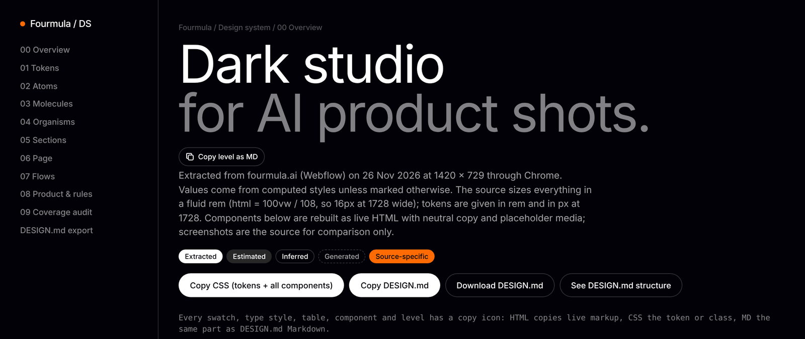
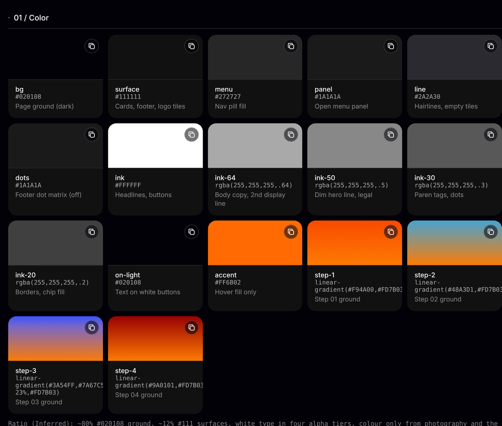
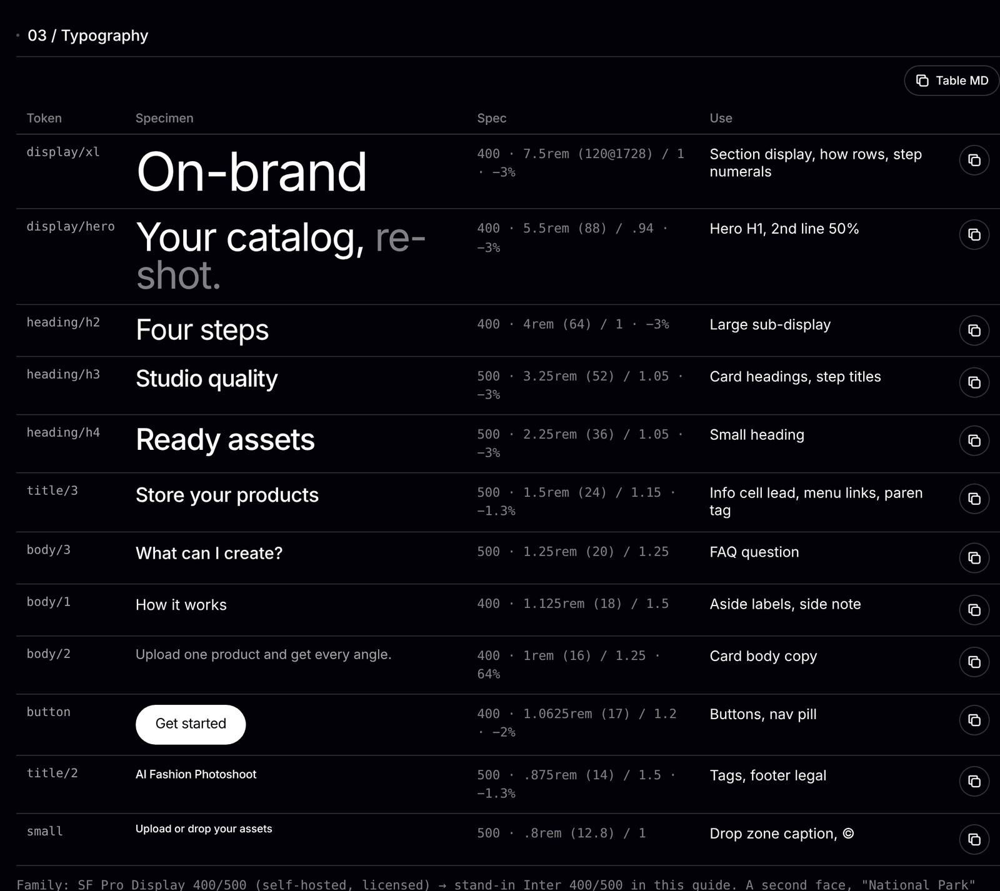
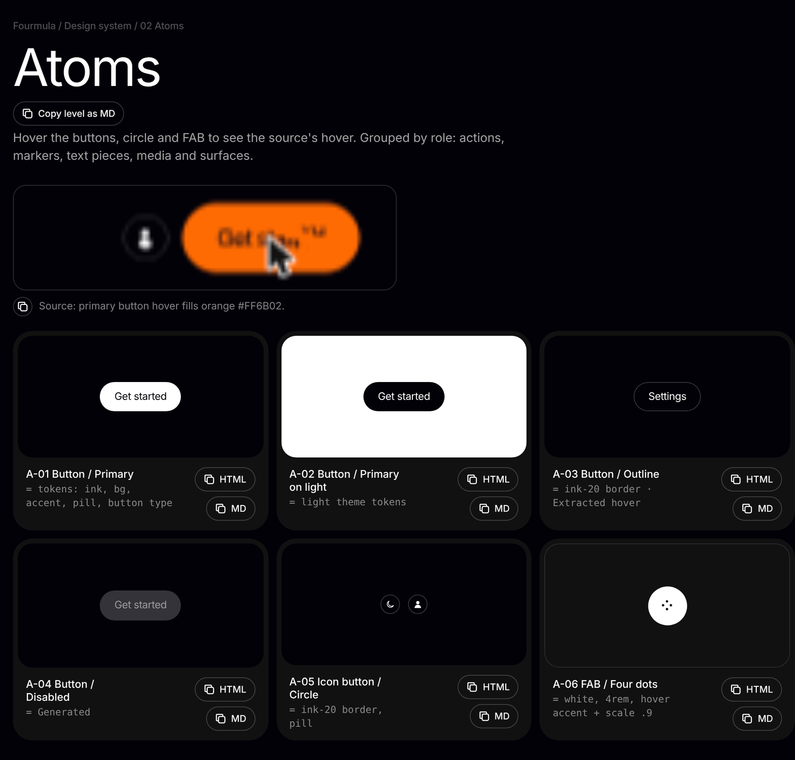
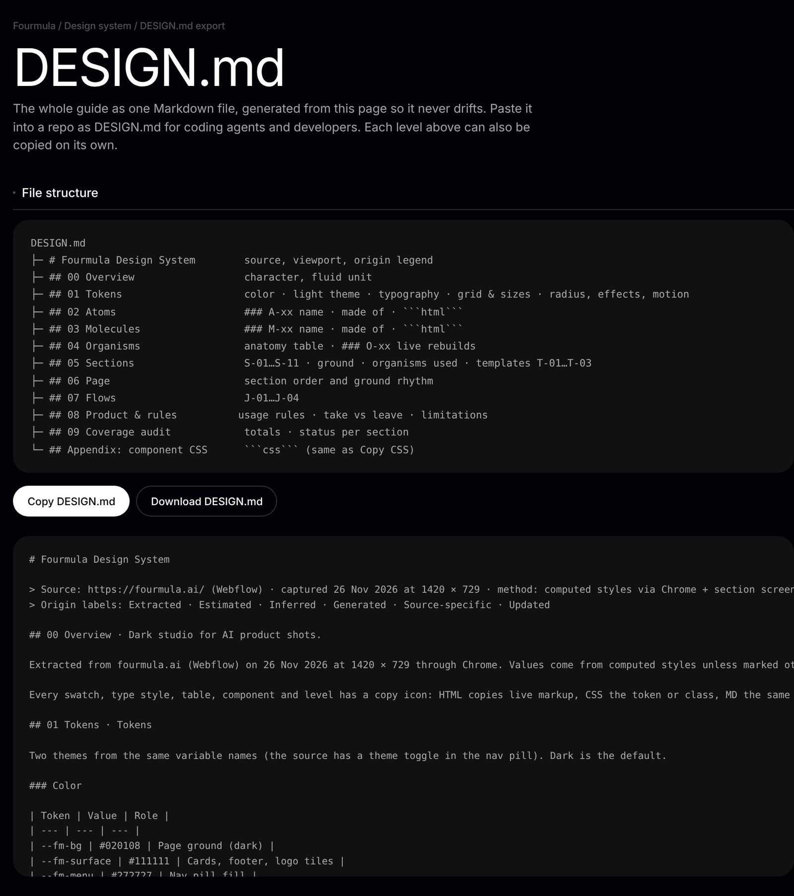

# Design System Extraction

Turn an authorized website, app, screenshot, design file, or codebase into a reusable, traceable design system—then build new pages from it.

[](https://skills.sh/yosrend/design-system-extraction)

## Why this skill

Most extraction workflows stop at a token list. This skill requires a visible, editable source capture; production-density specimen boards; traceable origins for every value; coverage accounting; accessibility checks; and a feedback loop that keeps the design system synchronized with new pages.

## What it produces

- Source capture: one screenshot (or editable render) per section at the source width
- A **Live HTML guide** organized by an 8-level hierarchy: 01 Tokens · 02 Atoms · 03 Molecules · 04 Organisms · 05 Sections & templates · 06 Pages · 07 Flows · 08 Product & rules · 09 Coverage
- Live rebuilt components with a **copy icon on every part** (HTML, CSS, Markdown) and a Copy CSS button
- A **DESIGN.md** export (copy or download) with a fixed structure any agent or repo can consume
- Origin labels for extracted, estimated, inferred, generated, source-specific, and updated values
- Accessibility checks, source provenance, coverage matrix, and documented limitations
- **Optional Figma handoff**: after the HTML guide, the agent asks whether to send the system to Figma. Yes → one "Design System" page with a Section per level, variables, text styles and real components built from instances. No → the workflow ends at HTML + DESIGN.md.

## Sample output

From a test run on a public site (fourmula.ai, 26 Nov 2026). Source photos and logos are left out; only the rebuilt guide is shown.

**Page structure.** Sticky index 00 Overview → 09 Coverage → DESIGN.md export, origin legend, and the Copy CSS / Copy DESIGN.md / Download DESIGN.md toolbar.



**01 Tokens: colors.** Every swatch has a copy icon that copies its CSS variable.



**01 Tokens: typography.** Live specimens with spec line, use, and a copy icon per style.



**02 Atoms.** Live rebuilt components with Copy HTML and Copy MD on every card.



**DESIGN.md export.** File structure panel and the generated Markdown.



DESIGN.md file structure:

```text
DESIGN.md
├─ # [Brand] Design System        source, viewport, origin legend
├─ ## 00 Overview                 character, grid, unit
├─ ## 01 Tokens                   color · typography · spacing & grid · radius, effects, motion · CSS
├─ ## 02 Atoms                    ### A-xx name · made of · states · ```html```
├─ ## 03 Molecules                ### M-xx name · made of · ```html```
├─ ## 04 Organisms                anatomy table · ### O-xx · ```html```
├─ ## 05 Sections & templates     S-xx · ground · organisms used · T-xx slots
├─ ## 06 Pages                    section order and rhythm
├─ ## 07 Flows                    J-xx journeys
├─ ## 08 Product & rules          experience · take vs leave · usage rules · limitations · changelog
├─ ## 09 Coverage                 totals · matrix (item, code, level, location, status)
└─ ## Appendix: component CSS     ```css``` (same as Copy CSS)
```

Full spec: [references/design-md.md](references/design-md.md).

## Workflow

```text
Reference → Capture → Decompose parts → Media rules → Extract 8 levels
  → Live HTML guide + DESIGN.md   (default endpoint)
  → "Send to Figma?"  ── no ──▶ done
                      └─ yes ─▶ Figma "Design System" page (Sections 00–09)
  → optional: build a new page, iterate, sync, variations, mobile
```

Reference files: [HTML guide spec](references/html-guide.md) · [DESIGN.md structure](references/design-md.md) · [Figma handoff recipe](references/figma-handoff.md)

## Install

### Automatic agent detection

Run this from your project root. The CLI detects supported agents already configured in the project:

```bash
npx skills add yosrend/design-system-extraction
```

### Codex

```bash
npx skills add yosrend/design-system-extraction \
  --skill design-system-extraction \
  --agent codex \
  -y
```

### Claude Code

```bash
npx skills add yosrend/design-system-extraction \
  --skill design-system-extraction \
  --agent claude-code \
  -y
```

### Cursor

```bash
npx skills add yosrend/design-system-extraction \
  --skill design-system-extraction \
  --agent cursor \
  -y
```

### Windsurf

```bash
npx skills add yosrend/design-system-extraction \
  --skill design-system-extraction \
  --agent windsurf \
  -y
```

### GitHub Copilot

```bash
npx skills add yosrend/design-system-extraction \
  --skill design-system-extraction \
  --agent github-copilot \
  -y
```

### Every detected agent

```bash
npx skills add yosrend/design-system-extraction \
  --skill design-system-extraction \
  --agent '*' \
  -y
```

Add `--global` to any command to install at user level instead of inside the current project.

List the skill without installing it:

```bash
npx skills add yosrend/design-system-extraction --list
```

## Supported sources

| Source | Fidelity | Handling |
| --- | --- | --- |
| Live URL | Exact where inspectable | Capture editable DOM/CSS and real assets |
| Design file or HTML import | Exact | Read editable node properties directly |
| HTML, CSS, JSX, or Tailwind | Exact | Render as editable HTML artboards |
| Screenshot or image | Estimated | Rebuild visually and label estimates |

## Required deliverables

1. Source capture preserved beside the system.
2. Live HTML guide with levels 00–09, copy-HTML on every part, Copy CSS, Copy/Download DESIGN.md.
3. DESIGN.md in the fixed structure.
4. Origin labels, accessibility checks, coverage matrix, source provenance, and limitations.
5. Figma "Design System" page — only when the user opts in.

Values are labeled as **Extracted**, **Estimated**, **Inferred**, **Generated**, **Source-specific**, or **Updated**.

## Example

> Extract a reusable design system from this authorized URL at 1680 wide. Build the HTML guide with copy icons and DESIGN.md, then ask me whether to send it to Figma.

The workflow is tool-agnostic and adapts to Claude Design, Figma, Pencil, Paper, or another editable design environment available to the host agent.

More ready-to-use requests are available in [examples/prompts.md](examples/prompts.md).

## Responsible use

Use only sources you own or are authorized to analyze. Do not republish protected brand assets, personal data, secrets, authenticated content, or hidden application state. Do not bypass access controls.

See [full documentation](docs/design-system-extraction.md) and [the skill definition](SKILL.md).

## Contributing

Issues and focused pull requests are welcome. Read the [contribution guide](docs/CONTRIBUTING.md) before proposing changes. Security concerns should follow the [security policy](docs/SECURITY.md).

## License

[MIT](LICENSE)
